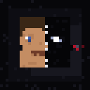

<p align="center"></p>

# Understudy

*Something learns how you play — and starts playing in your place.*
*Что-то изучает, как ты играешь, — и начинает играть вместо тебя.*

An unofficial add-on for **The Broken Script** (NeoForge 1.21.1, requires The Broken Script 2.0.5+).
Works in single player, on LAN and on dedicated servers; clients don't need it to join a server.

- What the mod does, config and AI setup: [MODRINTH.md](MODRINTH.md) (EN + RU)
- Step-by-step AI connection guide: [resources/understudy/AI-SETUP.txt](resources/understudy/AI-SETUP.txt)

## Source layout
| Path | What |
|---|---|
| `src/tbs/director/` | the director: player watching, scares, mimics, decay, echoes, AI (`Brain`), config, `/null` and `/nullAI` |
| `src/dev/mrainator/tbsecho/` | the "Protocol ECHO" story (EN/RU), optional old combat |
| `src/tbs/stats/` | tiny optional web server for the story archive (off by default) |
| `src/tbs/director/mixin/` | mixins: mimic hit handling, no water walking for mimics, chat hook |
| `resources/` | `neoforge.mods.toml`, mixin config, logo, AI guide |
| `test/` | self-tests (plain `main`, no framework) |
| `logo/` | logo and the script that draws it |

## Building
There is no Gradle setup yet: the mod is compiled with plain `javac` against the NeoForge 1.21.1 and The Broken Script jars.

```bash
# cp.txt = classpath with Minecraft 1.21.1 (NeoForge 21.1.x) libraries and The Broken Script 2.0.5 jar
find src -name '*.java' > sources.txt
javac --release 21 -proc:none -encoding UTF-8 -cp "@cp.txt" -d build/classes @sources.txt
cp -r resources/. build/classes/
jar --create --file understudy.jar -C build/classes .
```
Self-tests: compile `test/` against `build/classes` and run `tbs.director.DirectorSelfTest` and `EchoSelfTest`.

## License
MIT — see [LICENSE](LICENSE). The Broken Script itself is not part of this repository.
